# Jery 결정 모델 및 데이터 전략 독립 검토 보고서 (Decision-Data Strategy Review)

- **검토 일시**: 2026-10-17 (최종 설계 승인: 통합 전략안 서명 및 팩트 정정)
- **검토 주체**: `dev-agy` (데이터 검토 도구 및 결과 시각화 담당)
- **대상 범위**: Laya Multilingual FP16 LoRA vs Gemma 4 E4B Decision Head, 데이터 파이프라인, 숏리스트 편향, 내부 `window_none` 규약, 보정 및 평가 프로토콜
- **기반 문서**:
  - `/Volumes/Dove-Nest-SSD/projects/Jery/docs/data/decision-training-strategy.md` (최종 공동 통합 전략 문서)
  - `/Volumes/Dove-Nest-SSD/projects/Jery/tmp/codex-strategy-review.md` (Codex 독립 통합 메모)
  - `../main/docs/model/decision-strategy-review-20261017.md` (Claude 독립 모델 검토 보고서)
  - `/Volumes/Dove-Nest-SSD/projects/Jery/tmp/strategy-brief.md`
  - `/Volumes/Dove-Nest-SSD/projects/Jery/tmp/jev-decision-source.md` (Unsloth / PyTorchKR 원문)
  - `docs/review/weekend-data-audit.md` (dev-agy 독립 데이터 감사 보고서)
  - `docs/data/weekend-baseline-20261016.md` (선형 기준선 벤치마크 결과)
  - `docs/data/gemma-e4b-smoke.md` (Gemma 4 E4B 6-case 스모크 테스트)
  - `docs/contracts/prediction-v1.md` (공통 예측 계약 v1)
- **작업 원칙**: FINAL DESIGN SIGN-OFF ONLY (코드 수정·모델 학습·패키지 설치·Git 커밋/푸시 일체 배제, 최종 설계 검토 서명)

---

## 1. 총평 및 핵심 제언 (Executive Summary & Verdict)

### 1.1 결론 요약: Laya 322M 사전학습 헤드 적응을 1차 챌린저로 추진, Gemma 4 E4B는 조건부 비교군 유지
Mac mini M4 (통합 메모리 32 GiB, arm64) 환경에서 Jery의 목표는 **"1회 forward pass로 수십 밀리초 이내에 결정 유형과 다음 도구를 안정적으로 확정하는 경량 로컬 라우터"**다.

공동 통합 전략 문서([decision-training-strategy.md](/Volumes/Dove-Nest-SSD/projects/Jery/docs/data/decision-training-strategy.md)) 및 3개 에이전트 교차 검토를 종합한 결론:
1. **Laya Multilingual (322M)**:
   - 인코더 기반 모델로 텍스트 생성 루프가 없으며, 가중치 크기 약 678 MB, Apache 2.0 라이선스를 보유한다.
   - 기존 선형 기준선을 잇는 1차 챌린저로서 **"사전학습 헤드 적응(Head-only adaptation)"**을 우선 추진하고, 이후 LoRA 결합을 단계적으로 비교한다.
   - 구체적인 M4 환경에서의 지연시간(ms), MPS/MLX 메모리 점유 및 역전파 동작 여부는 사전 단언할 수 없으며, **32건 엔지니어링 스모크 픽스처**를 통해 실측 검증한다.
2. **Gemma 4 E4B (총 약 8.0B / 텍스트 유효 약 4.5B)**:
   - MoE가 아니며, **층별 임베딩(per-layer embeddings) 및 멀티모달 파라미터를 포함한 고밀도(DENSE) 디코더 모델**이다. 텍스트 유효 약 4.5B 대 총 약 8.0B의 차이는 활성 전문가(Active experts)를 의미하지 않는다.
   - 4비트 양자화 시에도 모델 크기 ~4.8 GiB, MLX 텍스트 생성 스모크에서 피크 메모리 5.034 GB, 추론 중앙값 5.1초를 기록하였다.
   - Unsloth MLX 결정 헤드 구현체(`decision.py`, `decision_mlx.py` 등)에 **`SPDX-License-Identifier: AGPL-3.0-only`**가 명시되어 있어 컴포넌트별 라이선스 확인 및 후속 검토가 필요하다.
   - Gemma 4-bit 결정 헤드는 Laya 파일럿 결과에 따라 검토할 **"조건부 품질 비교군"**으로 유지하며, 32 GiB 통합 메모리에서 Gemma BF16 전체 학습 시도는 실패 위험이 높아 1차 실험에서 유보한다.

### 1.2 핵심 설계 원칙 및 선행 가설 교정 (Challenging the Hypothesis)

| 검토 영역 | 선행 가설 및 기존 인식 | dev-agy 독립 데이터 감사 및 교차 검토 기반 수정안 |
|---|---|---|
| **1. 숏리스트 탈락과 계약 분리 ($C$ vs $S$)** | 숏리스트 8개에서 정답 도구가 누락되면 2단계 헤드가 `unsupported`로 오판하거나 오선택 위험. | **원래 후보 집합 $C$와 내부 숏리스트 $S$는 엄격히 구분**된다. $S$ 누락은 검색 실패(Retrieval Miss)이지 `unsupported`나 `clarify`가 아니다. 내부 전용 `window_none` 옵션을 도입하여 다음 창으로 검색을 확장하거나 원본 에이전트에 위임하며, 공개 계약(`prediction-v1`)의 의미를 훼손하지 않는다. |
| **2. 토큰 예산 실측 게이트** | 문자 수 기준 환산(예: 30자 $\times$ 8개)으로 256토큰 헤드 예산 준수를 약속함. | 문자 수 변환 가정을 배제하고, **Laya 공식 토크나이저로 실제 도구 설명 카드 및 센티널을 직접 토크나이징하여 실측**해야 한다. 긴 도구 ID만으로도 예산이 소진될 수 있으므로 동적 에일리어스 및 $k \in \{4, 8, 12\}$ 적응형 예산을 적용한다. |
| **3. 점수 결합 금지 및 조건부 불확실성** | 선형 점수와 결정 헤드 소프트맥스를 임의로 곱셈하여 결합하는 방안 언급, 단순 온도로 ECE 최소화 단정. | 숏리스트 소프트맥스는 조건부 확률 $P(\text{tool}_i \mid W)$이므로 사전 점수와 임의 곱셈이 불가하다. 단순 소프트맥스 온도는 전역 보정 성공 확률을 보장하지 않으므로 창 조건부 불확실성으로 보존하고, 별도 보정 분할(150 시나리오 그룹)에서 상대적 신뢰도를 평가한다. |
| **4. 선형 기준선과 평가 무결성** | 선형 기준선의 선택이 test셋에서 이루어졌다는 오해, 기존 test셋 재사용 우려. | 기존 선형 기준선의 하이퍼파라미터 선택은 **`validation` 분할**을 기준으로 수행되었다. 기존 test셋(246건)은 분석에 노출되었으므로 회귀 검증용으로 유지하고, 신규 모델의 최종 평가는 **독립 검토된 Fresh Test(200 시나리오 그룹)**에서 수행한다. |
| **5. 단계적 엔지니어링 접근** | 대규모 데이터셋(1,000건)과 실로그 수집을 모델 개발의 사전 필수 조건으로 요구. | **32건 엔지니어링 스모크 픽스처**를 먼저 구축하여 Laya 토크나이징, 헤드 입출력, forward/backward, 저장/로드 호환성을 먼저 검증한다. 1,000 시나리오 그룹은 최종 목표 역량 스위트이며, 실로그는 사용자 지침에 따라 선택적 후속으로 전환한다. |

---

## 2. 모델 후보 상세 비교 (Laya vs Gemma 4 vs Linear Baseline)

### 2.1 아키텍처 및 런타임 특성 매트릭스

| 비교 항목 | 기존 선형 기준선 (Linear Baseline) | Laya Multilingual (322M) Head / LoRA | Gemma 4 E4B (총 ~8.0B / 텍스트 유효 ~4.5B) |
|---|---|---|---|
| **모델 구조** | TF-IDF + LogisticRegression | Multilingual mmBERT 인코더 + Head | **DENSE 디코더 LLM (층별 임베딩 포함)** + Clef 결정 헤드 |
| **파라미터 규모** | 희소 특성 가중치 기반 | 322M (가중치 파일 ~678 MB) | 총 약 8.0B / 텍스트 유효 약 4.5B (4비트 ~4.8 GiB) |
| **프레임워크** | 순수 Python 표준 라이브러리 기반 | PyTorch MPS 또는 MLX (*스모크 실측 과제*) | MLX / MLX-LM |
| **M4 메모리 점유** | < 100 MB | *스모크 실측 과제* (가중치 ~678 MB) | 텍스트 생성 스모크 피크 5.034 GB / *헤드 실측 과제* |
| **추론 지연시간** | p50 1.306 ms / p95 6.310 ms | *스모크 실측 과제* (단일 forward pass) | 텍스트 생성 스모크 중앙값 5.1s / *헤드 실측 과제* |
| **옵션 컨텍스트 예산** | 제약 없음 (어휘 사전 기반) | 기본 1,024 토큰 (헤드 옵션 예산 ~256) | 최대 8,192 토큰 |
| **라이선스** | Apache 2.0 | **Apache 2.0** (가중치 및 공식 소스) | 가중치: Gemma 라이선스 / 코드: **AGPL-3.0-only** |
| **시스템 역할** | **1단계 빠른 후보 추출 (숏리스트)** | **2단계 로컬 의사결정 1차 챌린저** | **조건부 품질 비교군 / 오프라인 교사 모델** |

> [!NOTE]
> M4 하드웨어에서의 OS 상주 메모리 및 Laya MPS/MLX 지연시간/메모리 풋프린트는 가설적인 수치로 단언하지 않으며, 32건 스모크 테스트 픽스처에서 직접 프로파일링하여 확정한다.

### 2.2 컴포넌트별 라이선스 사실 및 검토 원칙
- `unsloth/models/decision.py`, `decision_mlx.py`, `unsloth_zoo/mlx/decision.py` 소스 파일 머리말에 **`SPDX-License-Identifier: AGPL-3.0-only`**가 명시되어 있다.
- Laya 공식 저장소(`NandhaKishorM/laya`)와 사전학습 가중치는 **Apache 2.0**이다.
- 각 구성 요소의 라이선스 사실을 명확히 기록하며, 향후 배포 단계에서 컴포넌트별 라이선스 검토를 진행한다.

---

## 3. 데이터 전략 및 목표 역량 스위트 (Target Capability Suite)

### 3.1 합성 데이터 v2 감사 팩트 (Audit Baseline)
`docs/review/weekend-data-audit.md`에서 확인된 객관적 데이터 상태:
1. **완전 미검토 합성 데이터**: 1,162건 전체가 `source=synthetic`, `needs_human_review=True`, `execution_verified=False`.
2. **평가 불가능 도구 존재**: 96개 도구 중 10개 도구가 train에만 존재하여 validation/test에서 양성 평가 불가능.
3. **결정 유형 불균형**: `select_tools`가 91.4% (1,062건)를 차지하여 단순 majority 찍기 모델도 91.4% 정확도를 기록.
4. **후보 개수 지름길**: `candidate_tools` 개수가 4개이면 100% 비선택(`no_tool`, `clarify`, `unsupported`)인 교란 요인 확인.

### 3.2 단계적 접근: 32건 스모크 $\rightarrow$ 최종 1,000 시나리오 그룹 목표 스위트

#### A. 32건 엔지니어링 스모크 픽스처 (Immediate Smoke Fixture)
- 모델 학습 및 토크나이저 검증의 블로커를 해소하기 위해 최소 32건의 픽스처(선택 16건, 비선택 16건)를 즉시 구성하여:
  1. Laya 토크나이저를 통한 실제 토큰 길이 실측.
  2. 사전학습 헤드의 forward/backward 그래디언트 생성 및 loss 수렴 확인.
  3. 가중치 저장 및 리로드 일치성을 먼저 확인한다.

#### B. 최종 1,000 시나리오 그룹 목표 역량 스위트 (Eventual Target Capability Suite)
- **실로그 의무 50% 요건 철회**: 사용자 지침에 따라 실제 Hermes 로그는 **선택적 후속(Optional later)**으로 전환한다. 초기 데이터 구축은 **새로 작성되어 검토된 휴먼 저작 시나리오 및 정제 합성 시나리오**로 충당 가능하다.
- **인위적 서버 캡(35% Grafana 캡 등) 폐지**: 서버별 비율을 인위적으로 제한하지 않고, 96개 모든 도구의 전 분할 전수 커버리지를 최우선으로 배치한다.
- **실현 가능한 정합 산술 (Feasible Target Arithmetic)**:

| 대표 사례 분할 | Train | Dev (Validation) | Cal (Calibration) | Fresh Test | 합계 (Total) |
|---|---:|---:|---:|---:|---:|
| **select_tools** | **384** | **96** | **96** | **96** | **672** (67.2%) |
| **no_tool** | **38** | **18** | **18** | **34** | **108** (10.8%) |
| **clarify** | **39** | **18** | **18** | **35** | **110** (11.0%) |
| **unsupported** | **39** | **18** | **18** | **35** | **110** (11.0%) |
| **합계 (Total)** | **500** | **150** | **150** | **200** | **1,000** (100.0%) |

> [!IMPORTANT]
> - 이 배치를 통해 `select_tools`의 비율이 기존 91.4%에서 67.2%로 현실화되어, 단순 찍기 모델의 성능 인플레이션을 억제한다.
> - 96개 모든 도구는 Train 4건, Dev 1건, Cal 1건, Fresh Test 1건으로 최소 7건이 배정되어, 전 분할에서 누락 도구 없이 정량적 평가가 가능해진다.

---

## 4. 숏리스트 검색 실패와 창(Window) 관리: 내부 `window_none` 규약

### 4.1 숏리스트 탈락의 본질 ($C$ vs $S$)
- **원래 허용 후보 집합 $C$**와 **내부 검색 숏리스트 $S$**는 개념적으로 완전히 다르다.
- 데이터의 정답 라벨(Gold label)은 시스템에 제공된 전체 후보 $C$에 종속되며, 1단계 검색기가 뽑아낸 숏리스트 $S$에 종속되지 않는다.
- 1단계 선형 라우터가 숏리스트 $S$를 추출할 때 정답 도구를 놓치는 현상(recall@k 실패)은 **검색 실패(Retrieval Miss)**이지, 해당 요청이 수행 불가(`unsupported`)하거나 모호한(`clarify`) 것이 아니다.

### 4.2 내부 `route_in_window` 질문과 `window_none` 해법 (오케스트레이션 합의)
- **내부 질문 규격 (`route_in_window`)**:
  - 2단계 결정 모델 헤드는 현재 창 $W$의 후보 $k$개와 함께 총 $k + 3$개의 옵션을 평가한다:
    - 현재 창 도구 $k$개
    - `no_tool`: 도구 실행 불필요
    - `clarify`: 문맥 모호
    - **`window_none`**: "현재 창 $W$ 안에는 적합한 도구가 없음" (내부 전용 옵션)
- **학습 타깃 매핑**:
  - 정답 도구가 전체 $C$에는 존재하지만 현재 평가 창 $W$에 없는 경우(음성 창) $\rightarrow$ 정답은 **`window_none`**.
  - 진정한 글로벌 `unsupported` 사례 (요청이 $C$ 전체로 처리 불가) $\rightarrow$ 모든 창 $W$에서 정답은 **`window_none`**.
  - 비표준 가짜 `unsupported` 라벨이나 fake padding, all-zero 타깃 없이 기존 soft cross-entropy 손실을 그대로 적용한다.
- **런타임 복구 및 공개 계약 보존**:
  - 현재 창에서 `window_none`이 출력되면:
    - 아직 확인하지 않은 후보 창이 남아있다면 다음 창($W_{next}$)으로 이동하여 평가.
    - 모든 창을 확인했거나 비용 한계 도달 시, 전체 후보 $C$를 가진 원본 에이전트에 위임(Delegate)하거나 선형 전체 결과를 참조.
  - **오직 전체 후보 $C$에 대한 모든 창 검토가 완료된 후에만** 런타임 래퍼가 공개 **`unsupported`**를 발행한다.
  - 확신도가 낮다는 이유만으로 기계적으로 `clarify`를 생성하지 않는다.

> [!NOTE]
> 이 절차가 모든 검색 누락이나 오판을 원천 방지한다는 뜻은 아니다. 정답 누락 상태에서 다른 도구를 높은 확신으로 오선택하는 오류율도 전체 평가에 명시적으로 포함하여 보고한다.

### 4.3 교란 변수(Confounders) 차단
1. **후보 개수 지름길 차단**: 모든 결정 클래스에 대해 동일한 숏리스트 후보 개수(동적 $k$)를 제공하여 $K=4$ 지름길 학습 차단.
2. **위치 순열(Position Permutation) 전면 적용**: 후보 도구 순서를 무작위 셔플하여 위치 편향 차단.

---

## 5. 분리된 보정(Disjoint Calibration) 및 Jev SystemOne 포맷 매핑

### 5.1 조건부 확률의 분리 보정 프로토콜
- 결정 모델의 소프트맥스는 현재 창 $W$ 내에서의 조건부 확률 $P(\text{tool}_i \mid W, x)$이다.
- 서로 다른 창의 확률이나 선형 모델 점수와의 임의 곱셈은 금지된다.
- **단순 소프트맥스 온도는 ECE 최소화나 전역 보정 정답 확률을 보장하지 않는다.**
- 따라서 확률은 창 조건부 불확실성(Conditional Uncertainty)으로 다루며:
  1. `train` 분할(500 시나리오 그룹)로 모델 학습.
  2. 별도의 **`cal` 분할(150 시나리오 그룹)**을 1단계 실제 검색기에 통과시켜 현실적인 숏리스트를 생성.
  3. 통과된 입력에 대해 2단계 모델의 상대적 신뢰도를 평가.
  4. 예측 계약 v1의 `confidence` 필드는 전역 성공 확률을 보장하는 필드가 아님을 명시.

### 5.2 Jev/Clef SystemOne 포맷 및 토크나이저 실측 게이트

Unsloth Decision API 및 Laya 표준 입력 포맷:

```json
{
  "state": "사용자 요청: OnCall 근무 shift-test의 상세 교대 시간을 확인해줘.\n이전 대화:\n[user]: 인프라 모니터링 현황을 점검 중이야.\n[assistant]: 어떤 시스템을 확인해 드릴까요?",
  "questions": {
    "decision_type": {
      "type": "choice",
      "instructions": "이 요청에 적합한 다음 처리 유형을 선택하세요.",
      "criteria": {
        "select_tools": "제공된 후보 도구 중 하나를 실행해야 함",
        "no_tool": "도구 실행 없이 일반 대화, 설명, 인사로 답변 가능",
        "clarify": "필수 파라미터나 대상이 모호하여 사용자에게 되물어야 함",
        "unsupported": "현재 후보 도구로는 처리할 수 없는 기능임"
      }
    },
    "tool_routing": {
      "type": "choice",
      "instructions": "현재 창의 후보 중 실행할 가장 적합한 도구를 고르세요.",
      "criteria": {
        "mcp__grafana__get_oncall_shift": "Grafana OnCall 근무 shift 교대 상세 시간 및 배정자 조회",
        "mcp__grafana__get_alert_group": "Grafana OnCall 알림 그룹 상태 및 페이로드 조회",
        "mcp__grafana__list_alert_groups": "Grafana OnCall 알림 그룹 목록 조회",
        "mcp__grafana__get_current_oncall_users": "현재 당직 근무자 목록 조회",
        "mcp__grafana__search_dashboards": "대시보드 검색 및 UID 확인",
        "mcp__grafana__get_datasource": "데이터소스 상세 설정 조회",
        "mcp__obsidian_vault__vault": "옵시디언 볼트 문서 조작",
        "mcp__swallow_trader__swallow_check_stock": "모의투자 종목 보유 여부 확인",
        "window_none": "현재 제시된 후보 중에는 적합한 도구가 없음"
      }
    }
  }
}
```

> [!WARNING]
> **토크나이저 실측 게이트 (Tokenizer Measurement Gate)**:
> - 문자 수에 기반한 임의 환산은 배제한다.
> - Laya의 실제 토크나이저(ModernBERT 기반)를 직접 실행하여 도구 ID, 요약 카드, 센티널 라벨의 합산 토큰 수를 실측하고 256토큰 헤드 예산 준수 여부를 검증한다.
> - 예산 초과 시에는 컴팩트 동적 에일리어스(`T1`, `T2` 등) 매핑 및 $k \in \{4, 8, 12\}$ 적응형 창 크기를 적용한다.

---

## 6. 액션(Action) 라벨링 및 복수 대안 정합성

### 6.1 Action Zero-Shot 결함 해결 방안 (계층적 2단계 질의)
- 1단계 질의에서 도구(`tool_routing`)를 먼저 결정한 후, 선택된 도구가 `action` enum을 가진 경우에만 스키마에 정의된 enum만을 선택지로 동적 구성하여 2단계 action 질문을 질의한다.
- 텍스트 옵션 점수화 방식이므로 훈련에 등장하지 않은 unseen action도 스키마 기반 점수화가 가능해진다.

### 6.2 복수 허용 대안(`acceptable_choices`)의 확률 비왜곡 규약
- 동일 도구에 속한 여러 액션이 대안 목록에 포함되어 있더라도, **도구 선택 소프트 타깃 계산 시에는 도구 ID의 중복을 먼저 제거(Deduplicate tool IDs first)**한다.
- 중복을 제거하지 않으면 동일 도구의 여러 액션이 존재한다는 이유만으로 특정 도구의 확률 질량이 왜곡 증폭되는 문제를 차단한다.

---

## 7. 독립 평가 프로토콜 (Fresh Test) 및 파일럿 검증 게이트

### 7.1 Fresh Test (200 시나리오 그룹) 요건
- 기존 v2 `test.jsonl`(246건)은 회귀 검증용으로 유지.
- 독립 신규 테스트셋(Fresh Test, 200 시나리오 그룹) 구축:
  1. 96개 모든 도구에 대해 최소 1건 이상 양성 타겟 포함 (`select_tools` 96건).
  2. non-select 3종 집중 평가 (`unsupported`, `clarify`, `no_tool` 총 104건).
  3. 모델 개발 단계에서는 비공개(Held-out) 유지.

### 7.2 파일럿 채택 및 검증 게이트 (Pilot Acceptance Gates)

| 게이트 ID | 평가 영역 | 검증 기준 및 확인 사항 |
|---|---|---|
| **GATE-0 (Smoke)** | **토크나이저 및 런타임 호환성** | Laya 토크나이저 실측 헤드 옵션 토큰 수가 예산(256) 내에 안착하며, M4 환경에서 forward/backward 그래디언트 생성 및 저장이 정상 동작함. |
| **GATE-1 (Accuracy)** | **도구 선택 정확도 (Fresh Test)** | 96개 도구 전수 평가에서 기존 선형 기준선(Validation 기준 튜닝) 대비 유의미한 정확도 향상 입증. |
| **GATE-2 (Macro-F1)** | **결정 유형 균형 (Macro-F1)** | `select_tools` 편중 없이 non-select 3종 전반에서 고른 식별력 유지. |
| **GATE-3 (False Unsupp)**| **검색 실패 분리 (False Unsupported)**| 숏리스트 누락으로 지원 가능한 요청이 잘못 거절(`unsupported`)되는 비율을 최소화하고 창 확장/위임으로 정상 흡수. |
| **GATE-4 (Latency/RAM)**| **M4 런타임 실측 (Latency / Peak RAM)**| 단일 forward pass 추론 지연시간과 메모리 점유가 실제 측정되어 Hermes 동시 상주 가용 범위 내에 안착. |
| **GATE-5 (Governance)** | **컴포넌트 라이선스 확인 (Component License Review)**| 배포 전 컴포넌트별 라이선스 검토를 완료하고 Apache 2.0 라이선스 체계 유지. |

---

## 8. 최종 통합 전략안 서명 및 교차 검토 (Final Plan Sign-off)

### 8.1 통합 전략안 서명 (Sign-off Statement)

- **승인 여부 (Accept)**: **전면 승인 (Full Sign-off)**
  - 최종 통합안([decision-training-strategy.md](/Volumes/Dove-Nest-SSD/projects/Jery/docs/data/decision-training-strategy.md))에 수립된 아키텍처 원칙(Laya 322M 사전학습 헤드 적응 1차 $\rightarrow$ LoRA 2차 $\rightarrow$ 조건부 Gemma 4-bit 비교군, BF16 1차 유보), 내부 `window_none` 질문 규약, 32건 엔지니어링 스모크 선행 및 1,000건 대표 사례 층화 쿼터(Train 500 / Dev 150 / Cal 150 / Fresh Test 200, 서버별 인위적 캡 폐지)에 전면 동의하고 서명한다.
- **차단성 변경 요구 (Blocking Changes)**: **없음 (None)**
  - 오케스트레이션 조정과 통합 문서를 통해 $C / W / \text{window\_none}$ 분리, 계약 보존, 실로그 요건 유연화, DENSE 팩트 정정 및 컴포넌트 라이선스 정리가 완료되었으므로 추가 차단성 이슈 없음.
- **남은 미확인 과제 (Remaining Unknowns & Empirical Gates)**:
  1. **Laya 토크나이저 실측**: ModernBERT 기반 공식 토크나이저로 측정한 실제 도구 카드 및 센티널의 토큰 수가 256 예산에 안착하는지 여부.
  2. **M4 하드웨어 백엔드**: PyTorch MPS 및 MLX 로더에서 Laya 체크포인트의 실제 로드, 역전파 기울기 생성, 가중치 저장/복원 동작 여부 (32건 스모크 측정 과제).
  3. **Gemma 4 E4B 4-bit 로더**: 이미 다운로드된 MLX 사전 양자화 폴더의 로드 가능 여부 및 Qwen 대화 템플릿의 영향.
  4. **다중 창 순회 지연 및 오선택**: 실제 런타임에서 여러 창을 순회할 때의 최악 지연시간과, 창 내 정답 부재 시 다른 도구를 오선택하는 비율.
  5. **조건부 확률의 실제 보정 거동**: 창 내 조건부 소프트맥스 확률과 실제 전역 선택 성공 신뢰도 간의 상관관계.

> [!CAUTION]
> 본 설계가 모든 검색 누락이나 오판을 원천 방지하지 않으며, 파일럿 런타임 성능은 사전 검증된 사실이 아닌 32건 스모크 및 Fresh Test에서 측정해야 할 대상이다.

---

## 9. 단계별 실행 로드맵 및 에이전트 역할 분담

```mermaid
flowchart LR
    subgraph Phase0["0단계: 엔지니어링 스모크 & 실측"]
        S1["dev-claude: 32건 스모크 픽스처 구축"]
        S2["dev-claude: Laya 토크나이저 & 백엔드 실측"]
    end
    subgraph Phase1["1단계: 데이터 정비 & 계약"]
        D1["dev-codex: 1,000 시나리오 그룹 목표 쿼터 빌드"]
        D2["dev-agy: 검토 UI 개선 & SystemOne 변환기"]
    end
    subgraph Phase2["2단계: 파이프라인 & 모델 학습"]
        M1["dev-codex: 창 관리 & window_none 오케스트레이션"]
        M2["dev-claude: Laya 사전학습 헤드 적응 & LoRA 학습"]
        M3["dev-claude: 분리 보정 (Calibration) 피팅"]
    end
    subgraph Phase3["3단계: 독립 검증 & 게이트 판정"]
        V1["dev-agy: Fresh Test 블라인드 감사"]
        V2["dev-codex: 채택 게이트 6종 평가 & 최종 통합"]
    end

    Phase0 --> Phase1 --> Phase2 --> Phase3
```



1. **0단계: 엔지니어링 스모크 및 실측 (Phase 0)**
   - `dev-claude`: 32건 스모크 픽스처로 Laya 토크나이저 토큰 길이 측정, MPS/MLX backward 및 가중치 저장 검증.
2. **1단계: 데이터 정비 및 SystemOne 매핑 (Phase 1)**
   - `dev-codex`: $K$-count 교란 요인이 제거된 목표 시나리오 그룹 구축 (Train 500, Dev 150, Cal 150, Fresh Test 200).
   - `dev-agy`: 검토 UI에 도구 1줄 요약 카드 편집 기능 지원 및 SystemOne choice 매핑 변환기 구현.
3. **2단계: 파이프라인 및 Laya 모델 학습 (Phase 2)**
   - `dev-codex`: `runtime/`에 동적 창($k \in \{4, 8, 12\}$) 및 `window_none` 기반 확장/위임 안전망 구현, 다중 대안 중복 제거 소프트 타깃 매핑.
   - `dev-claude`: Laya Multilingual (322M) 사전학습 헤드 적응 및 LoRA 학습 (soft cross-entropy), 별도 `cal` 분할(150건)에서 상대 신뢰도 피팅.
4. **3단계: 독립 검증 및 프로덕션 채택 판정 (Phase 3)**
   - `dev-agy`: 완전히 분리된 Fresh Test(200 시나리오 그룹) 대상 채택 게이트 감사 및 시각화 보고서 발행.
   - `dev-codex`: 게이트 통과 여부 검증 후 최종 런타임 확정.

---

## 10. 한계 및 파일럿 실측 과제 (Explicit Unknowns & Smoke Gates)

1. **Laya 토크나이저의 한국어 기술 어휘 분할 효율 실측**: ModernBERT 토크나이저가 한국어 기술 어휘를 몇 개의 서브워드로 분할하는지 32건 스모크 단계에서 실측.
2. **M4 런타임 지연시간 및 메모리 실측**: 단일 forward pass 시간과 역전파 시 피크 메모리를 직접 측정하여 백그라운드 상주 가능성 확정.
3. **실제 다중 턴 대화 맥락 유지력**: 실제 복잡한 다중 턴 대화에서 인코더가 의도를 얼마나 안정적으로 보존하는지는 후속 실로그 검토 단계에서 평가.
